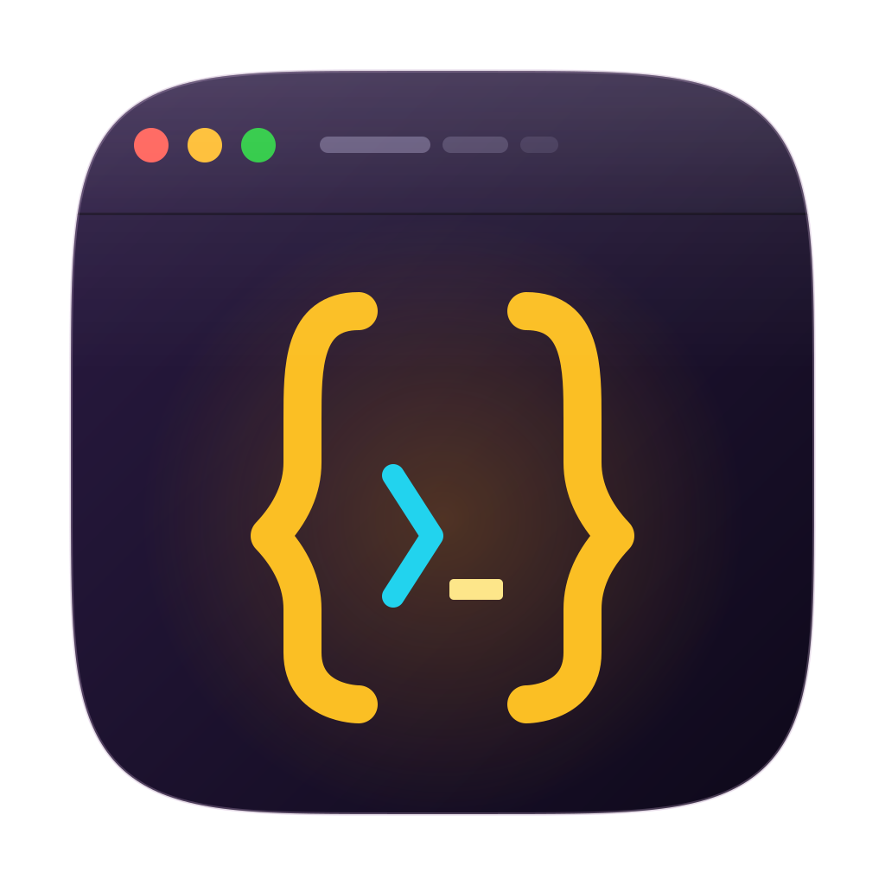
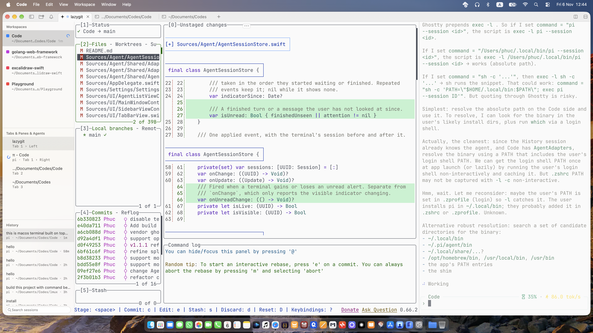
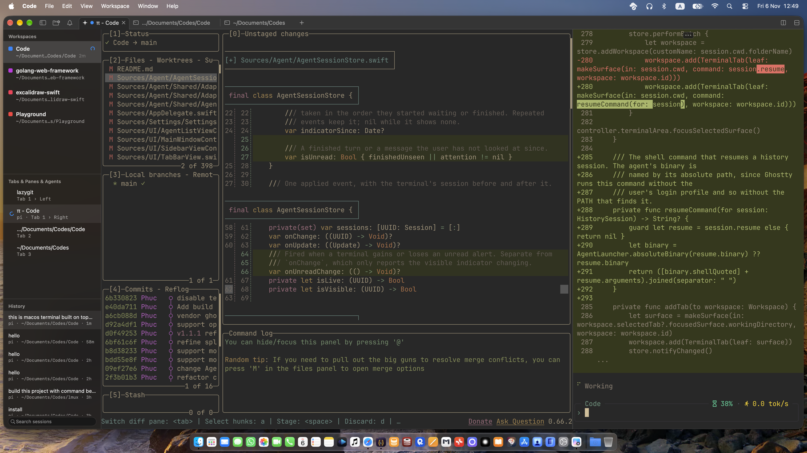

<p align="center">
  
</p>

# Code

A more productive terminal.

[Download](https://github.com/phucngodev/code/releases/latest)

A native, small, fast terminal built on Ghostty. Code is a Swift and AppKit app with no Electron and no web view, so it starts fast and stays out of the way. No accounts, no telemetry.

Run Claude Code, Codex, OpenCode and Pi side by side in split panes, each in its own workspace with its own path.

It ships a separate build for each chip, so a download carries only what your Mac needs:

| Build  | App   | DMG     |
| ------ | ----- | ------- |
| arm64  | 17 MB | 7.21 MB |
| x86_64 | 17 MB | 7.54 MB |

A single universal build for both chips would be about 37 MB, roughly double the download.





## Why Code?

**Native and fast.** Code is a Swift and AppKit app powered by libghostty. There is no Electron and no web view.

**Made for agents.** Code shows what Claude Code, Codex, OpenCode and Pi are doing in each workspace, and tells you when one finishes or needs you. See [Agents](#agents).

**Private and simple.** No account, no telemetry, no tracking. Your terminal is yours.

## Install

Code needs macOS 13 or later.

1. Download the latest `.dmg` for your Mac from [releases](https://github.com/phucngodev/code/releases/latest) — `arm64` for Apple silicon, `x86_64` for Intel.
2. Open it and drag Code into Applications.
3. xattr -c /Applications/Code.app.
4. Open Code.

Code does not update itself. Download a newer `.dmg` from the same page to update.

## Getting around

Each project gets its own workspace in the sidebar, with its own tabs and split panes. A workspace is named after the git repository it's in, with its path and branch underneath. Code reopens everything as you left it.

After a relaunch, restored terminals start when you first view them. Once started, they keep running when you switch to another tab or workspace.

Drag workspaces up or down in the sidebar to reorder them. Code remembers their order when you reopen it.

| Shortcut                              | Action           |
| ------------------------------------- | ---------------- |
| <kbd>⌘</kbd><kbd>N</kbd>              | New workspace    |
| <kbd>⌘</kbd><kbd>T</kbd>              | New tab          |
| <kbd>⌘</kbd><kbd>D</kbd>              | Split right      |
| <kbd>⌥</kbd><kbd>1</kbd>–<kbd>9</kbd> | Switch workspace |
| <kbd>⌘</kbd><kbd>1</kbd>–<kbd>9</kbd> | Switch tab       |
| <kbd>⌘</kbd><kbd>,</kbd>              | Settings         |

Click the <kbd>?</kbd> button in the title bar to see every shortcut.

## Agents

Run `claude`, `codex`, `opencode` or `pi` in a Code terminal and the workspace shows what it is doing:

| Dot           | Meaning                                          |
| ------------- | ------------------------------------------------ |
| Blue, pulsing | The agent is working                             |
| Yellow        | The agent is waiting for you                     |
| Green         | A turn finished while you were looking elsewhere |

Looking at the terminal clears the green dot. A terminal you are not looking at also gets a macOS notification, which focuses it when clicked, and a sound: one when an agent needs you, another when it finishes. Pick the sounds, or turn them and the notifications off, in **Settings › Notifications**.

Code does this through the agents' own hooks and plugins. For Claude, Codex and OpenCode it adds them at each launch, without writing to `~/.claude`, `~/.codex` or `~/.config/opencode`. Pi is not shadowed on PATH: once Pi has a config folder, Code installs its extension into `~/.pi/agent/extensions` at each launch, so `which pi` keeps pointing at your own install. An agent started outside Code behaves exactly as before. There is nothing to set up for fish and zsh. Two things need a step from you:

**Bash.** Code cannot add itself to bash. Put this at the end of `~/.bashrc` or `~/.bash_profile`:

```bash
[ -n "$CODE_CDE" ] && source "${CODE_CDE%/*}/../Resources/shell-integration/bash/code.bash"
```

**Codex.** Codex runs a hook only after you have reviewed it. The first time you start `codex` in Code, run `/hooks` inside it and trust the Code hooks. Codex remembers your answer, and asks again only if Code moves to a different location or an update changes its hooks.

To run an agent without Code's hooks for one session, start it with `CODE_AGENTS_DISABLED=1`.

## Configuration

Choose **Code › Settings…** (<kbd>⌘</kbd><kbd>,</kbd>) to pick the shell, a theme for light mode and one for dark mode, the font, cursor, window opacity and blur, and agent sounds. The sidebar and title bar follow the theme, so a dark theme gets a dark sidebar even in light mode.

Settings writes to `~/.config/code/config`, a plain text file in Ghostty's format that you can also edit by hand. The first time Code opens, it copies your Ghostty config into this file, so your fonts, theme and keybindings carry over. After that, Code reads only its own file. Settings changes only the lines it needs to and keeps your comments. **Settings › Advanced** opens the file in your editor and lists any problems in it.

Code aims to support every Ghostty setting, but some don't work in Code yet. If a setting you rely on has no effect, [open an issue](https://github.com/phucngodev/code/issues/new).

## Build from source

You need Xcode 27, Zig 0.17 and xcodegen (`brew install zig xcodegen`).

```sh
git clone --recursive https://github.com/phucngodev/code.git && cd code
./scripts/build-ghosttykit.sh   # builds libghostty, slow, only needed once
xcodegen generate               # writes code.xcodeproj from project.yml
open code.xcodeproj
```

To build without opening Xcode, run `xcodebuild -scheme code -configuration Release build -derivedDataPath build`.

To build the release DMGs for both chips, run `./scripts/build-release.sh`. It writes `dist/Code-<version>-arm64.dmg` and `dist/Code-<version>-x86_64.dmg`. They are signed for local use only, not notarized.

`Vendor/ghostty` is a git submodule pinned to Ghostty's latest stable release. `patches/` holds build fixes for Xcode 27 that landed upstream after that release, and the build script applies them.

### Tests

```sh
xcodebuild test -scheme code -destination 'platform=macOS'
```

The tests cover the models and terminal lifecycle without launching the app.

### Layout

| Directory            | Contents                                                                                         |
| -------------------- | ------------------------------------------------------------------------------------------------ |
| `Sources/Ghostty/`   | The wrapper around libghostty's C API, with the runtime, config, input and terminal view         |
| `Sources/Workspace/` | The workspace, tab and pane model. It's generic over `PaneLeaf`, so tests run without terminals. |
| `Sources/Agent/`     | Each terminal's agent status, its notifications and sounds, and the socket agents report to      |
| `Sources/Settings/`  | The Settings window and the reader and writer for Code's config file                             |
| `Sources/UI/`        | The AppKit window, with the sidebar on the left and terminals on the right                       |
| `Tests/`             | Unit tests for the model                                                                         |

`Vendor/GhosttyKit.xcframework` and `Vendor/GhosttyResources` are build outputs and aren't committed.

## License

Code is released under the [MIT License](LICENSE).
